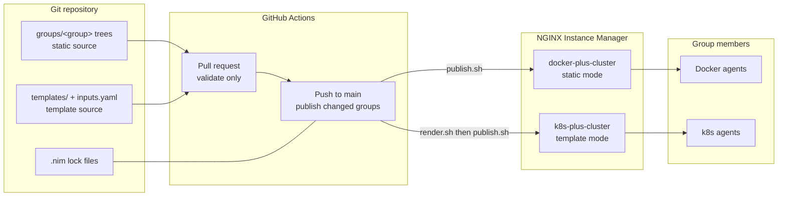
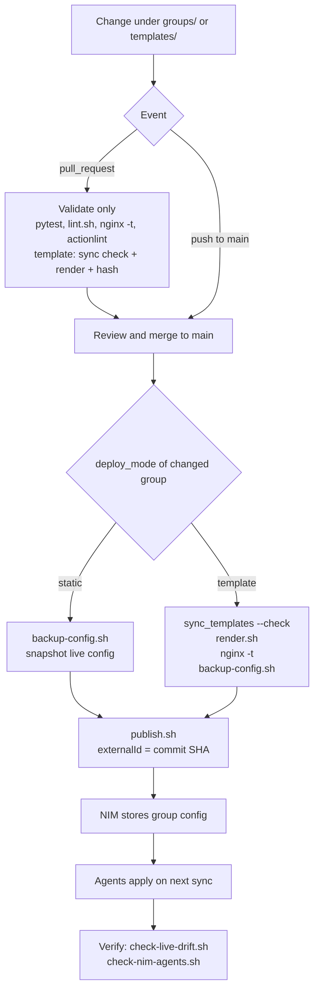
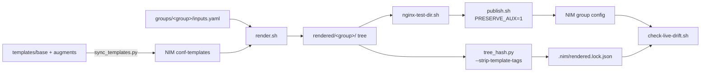
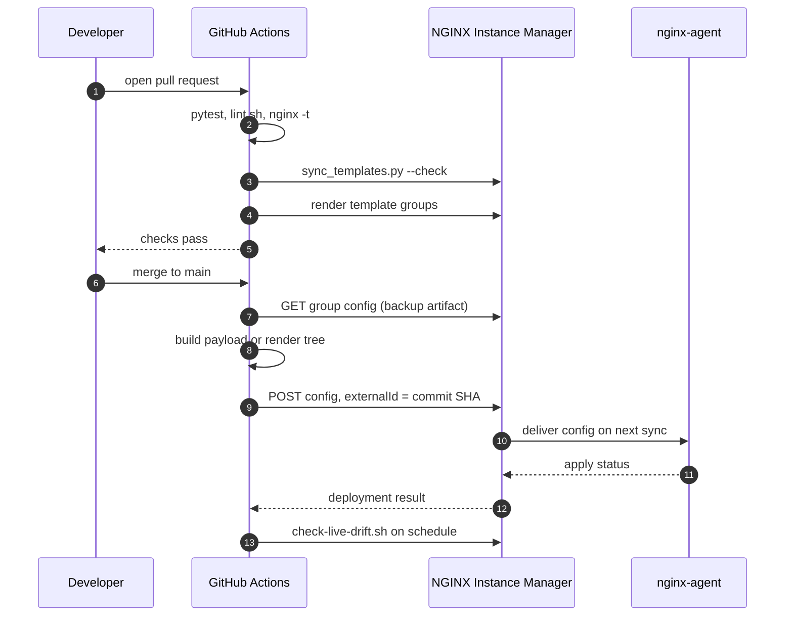

# Deployment workflow

How a change in this repository reaches an NGINX Instance Manager (NIM) instance group.

A group is deployed in exactly one of two modes, set by `deploy_mode` in
`groups/<group>/group.yaml`:

| Mode | Source of truth | Publisher | Workflow |
|---|---|---|---|
| `static` | `groups/<group>/*.conf` | `scripts/publish.sh` | `.github/workflows/nginx-config.yml` |
| `template` | `templates/` + `groups/<group>/inputs.yaml` | `scripts/render.sh` → `scripts/publish.sh` | `.github/workflows/nginx-template.yml` |

The `deploy_mode` gate is the only thing that stops both workflows publishing the same group.
Never remove it and never let two workflows own one group.

Current groups:

- `docker-plus-cluster` — **static**; payload `nginx.conf`, `conf.d/site.conf`, `mime.types`.
- `k8s-plus-cluster` — **template**; `nginx-base` + `site-k8s`, with `/etc/nginx/tls/tls.crt`
  preserved as an aux file.

## At a glance



## Workflow files

| File | Workflow `name` | Runs on | Jobs |
|---|---|---|---|
| `nginx-config.yml` | `nginx-config` | PR, push to `main`, manual | `lint + nginx -t`, `detect changed static groups`, `publish <group>` |
| `nginx-template.yml` | `nginx-template` | PR, push to `main`, weekly schedule, manual | `validate template groups`, `check live drift`, `detect changed template groups`, `publish <group>` |

Branch protection on `main` requires the exact status context **`lint + nginx -t`**. Keep that job
name when editing `nginx-config.yml`.

Both publish jobs use the `nim` GitHub environment and the serialized concurrency group
`nim-group-<group>`, so two runs never publish the same group at once.

## Change pipeline



### On a pull request — validate, never publish

Static (`nginx-config.yml`, job `lint + nginx -t`):

1. `pytest -q`
2. `./scripts/lint.sh` — invariants for every static group
3. `./scripts/nginx-test.sh` — real `nginx -t` per static group (OSS image, Plus block neutralised)
4. `actionlint`

Template (`nginx-template.yml`, job `validate template groups`):

1. `./scripts/lint.sh` and `pytest -q`
2. `python3 scripts/sync_templates.py --all --check` — local templates must match NIM
3. render every template group with `DRY_RUN=1`, then `CHECK_HASH=1` against
   `.nim/rendered.lock.json`
4. render for real and run `./scripts/nginx-test-dir.sh rendered/<group>`

### On merge to `main` — publish only what changed

1. **Detect.** `scripts/list-groups.sh static|template` supplies the mode list. The `changed` job
   diffs `groups/` against the push range and keeps only groups whose `deploy_mode` matches the
   workflow. A `templates/` or `.nim/` change selects **every** template group. Manual dispatch
   selects every group for that mode.
2. **Back up.** `scripts/backup-config.sh` snapshots the group's *current* NIM config, uploaded as a
   90-day artifact `nim-group-config-backup-<group>-<run_id>`.
3. **Build.** Static uses `groups/<group>/`; template runs `render.sh` into `rendered/<group>/`.
4. **Publish.** `scripts/publish.sh` posts the tree with `externalId = <commit SHA>` and
   `PRESERVE_AUX=1`.
5. **Wait.** The job fails on `details.failure`, `details.error`, or when no member reported an
   outcome.

> A group with offline members still accepts the publish. NIM reports `status: successful` with
> empty `details`, and the config applies when the member reconnects. Check
> `GET /systems/{uid}` `.status.state` before treating that timeout as a bad config.

## Static path, step by step

1. Edit or add files under `groups/<group>/`.
2. Include **every** file the group owns. A publish is declarative over the tree: a file you omit is
   deleted on the members.
3. Make the tree self-contained. Every explicit `include /etc/nginx/<path>;` must exist in the tree
   (`mime.types` included). `scripts/lint.sh` enforces this.
4. Validate locally:

   ```bash
   ./scripts/lint.sh
   ./scripts/nginx-test-dir.sh groups/<group>
   GROUP=<group> CONFIG_DIR=groups/<group> PRESERVE_AUX=1 DRY_RUN=1 \
     NIM_URL=… NIM_USER=… NIM_PASSWORD=… NIM_MGMT_ENDPOINT=… ./scripts/publish.sh
   ```

5. Open a PR. On merge the static workflow publishes the changed group.

## Template path, step by step



1. Edit the template under `templates/`, or the group's `inputs.yaml`.
2. Apply template edits to NIM **before merging**:

   ```bash
   NIM_URL=… NIM_USER=… NIM_PASSWORD=… python3 scripts/sync_templates.py --all
   ```

   CI runs `--check` and fails if NIM and Git differ.
3. Render and lock the hash:

   ```bash
   GROUP=<group> OUT_DIR=rendered/<group> WRITE_HASH=1 HASH_FILE=.nim/rendered.lock.json \
     NIM_URL=… NIM_USER=… NIM_PASSWORD=… NIM_MGMT_ENDPOINT=… ./scripts/render.sh
   ```

4. Inspect and test the composed tree:

   ```bash
   diff -ru groups/<group> rendered/<group> \
     --exclude group.yaml --exclude inputs.yaml --exclude render-manifest.txt
   ./scripts/nginx-test-dir.sh rendered/<group>
   ```

5. Open a PR. On merge the template workflow re-renders, re-tests, and publishes.

The lock hash is computed with `tree_hash.py --strip-template-tags` because NIM emits a
nondeterministic `# __templateTag=...` comment naming whichever augment was composed last.

### The mgmt endpoint

`mgmt { usage_report endpoint=...; }` ships with the placeholder `nim-mgmt-endpoint.invalid`.
Both `render.sh` and `publish.sh` replace it with `$NIM_MGMT_ENDPOINT` before hashing and before the
POST, so the lock, the written tree, and the live config agree. If a tree still contains the
placeholder and the variable is unset, the script exits with an error.

A group can instead set `mgmt_endpoint` in `inputs.yaml`; an explicit value is used as-is and no
substitution happens. `NIM_MGMT_ENDPOINT` is a repository secret, available to every job that has
`environment: nim`.

### Publish sequence



## Verification

```bash
export NIM_MGMT_ENDPOINT=…                  # needed by render.sh and publish.sh
./scripts/lint.sh
./scripts/nginx-test.sh                      # static groups
./scripts/nginx-test-dir.sh rendered/<g>     # template group
python3 scripts/sync_templates.py --all --check
GROUP=<g> CHECK_HASH=1 HASH_FILE=.nim/rendered.lock.json ./scripts/render.sh   # template
GROUP=<g> ./scripts/check-live-drift.sh      # template
./scripts/check-nim-agents.sh
./scripts/list-groups.sh static
./scripts/list-groups.sh template
```

Expected: each group appears under exactly one mode, lint and `nginx -t` pass, templates are in
sync, live drift is `none` for template groups, and every NIM system is online.

`check-live-drift.sh` hashes `configFiles` only. Aux files such as `/etc/nginx/tls/tls.crt` are
outside the Git-declarative set and are carried forward by `PRESERVE_AUX=1`.

## Rollback

See `runbooks/static-vs-template.md` §5. In short: make the static tree self-contained, validate
it, flip `deploy_mode` to `static`, and let the static workflow publish. The template augment file
is deleted by the classic publish; aux files survive because both workflows set `PRESERVE_AUX=1`.

## Where the pieces live

| Path | Purpose |
|---|---|
| `groups/<group>/group.yaml` | `name`, `require_mgmt`, `deploy_mode` — mode gate |
| `groups/<group>/inputs.yaml` | template-mode `baseData` and `augmentData` |
| `templates/base/*/meta.yaml` | template name, type, and file map |
| `.nim/templates.lock.json` | template name → NIM uid |
| `.nim/rendered.lock.json` | group → canonical render hash |
| `rendered/<group>/` | last composed tree (gitignored) |
| `backup/<group>/` | last live snapshot from CI (gitignored) |
